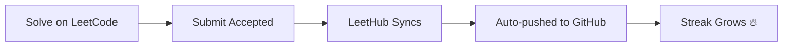

<div align="center">


<a href="https://github.com/samihan45">
  
</a>

<br/>


</div>

---

## 👋 About This Repository

Welcome to my **Data Structures & Algorithms** journey!
Every solution I submit on **LeetCode** is automatically synced here, so this repo is a living record of my growth as a problem solver.

> *"The best way to learn DSA is to solve, fail, understand, and solve again."*

---

## 📊 My LeetCode Stats

<div align="center">


</div>

---

## 🔥 GitHub Streak

<div align="center">


</div>

---

## 🧠 Topics I'm Covering

| Topic | Status |
|-------|--------|
| 📦 Arrays & Hashing | ✅ Done |
| 👉 Two Pointers | ✅ Done |
| 🪟 Sliding Window | 🔄 In Progress |
| 📚 Stack & Queue | 🔄 In Progress |
| 🔍 Binary Search | ⏳ Upcoming |
| 🔗 Linked List | ⏳ Upcoming |
| 🌳 Trees & BST | ⏳ Upcoming |
| ⛰️ Heap / Priority Queue | ⏳ Upcoming |
| 🕸️ Graphs | ⏳ Upcoming |
| 🧩 Backtracking | ⏳ Upcoming |
| 🧮 Dynamic Programming | ⏳ Upcoming |
| 🔤 Tries & Greedy | ⏳ Upcoming |

---

## 🗂️ Repository Structure

```
📁 Mess-Mate-
 ├── 📁 0001-two-sum
 │    ├── 📄 README.md      → problem statement
 │    └── 📄 solution.cpp   → my accepted solution
 ├── 📁 0002-add-two-numbers
 └── ...
```

Each folder contains the **problem description**, my **accepted solution**, and sometimes notes on the approach.

---

## ⚙️ How It Works



---
## 🛠️ Tech & Tools

<div align="center">


</div>

---

## 🤝 Let's Connect

<div align="center">

[](https://leetcode.com/samihanacharya)
[](https://linkedin.com/in/YOUR_LINKEDIN)
[](https://github.com/samihan45)

⭐ *If this repo inspires you, give it a star and start your own journey!* ⭐

</div>


